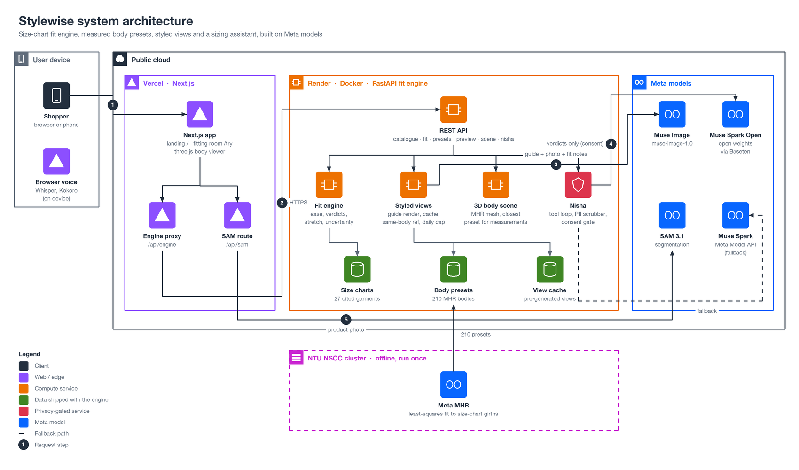
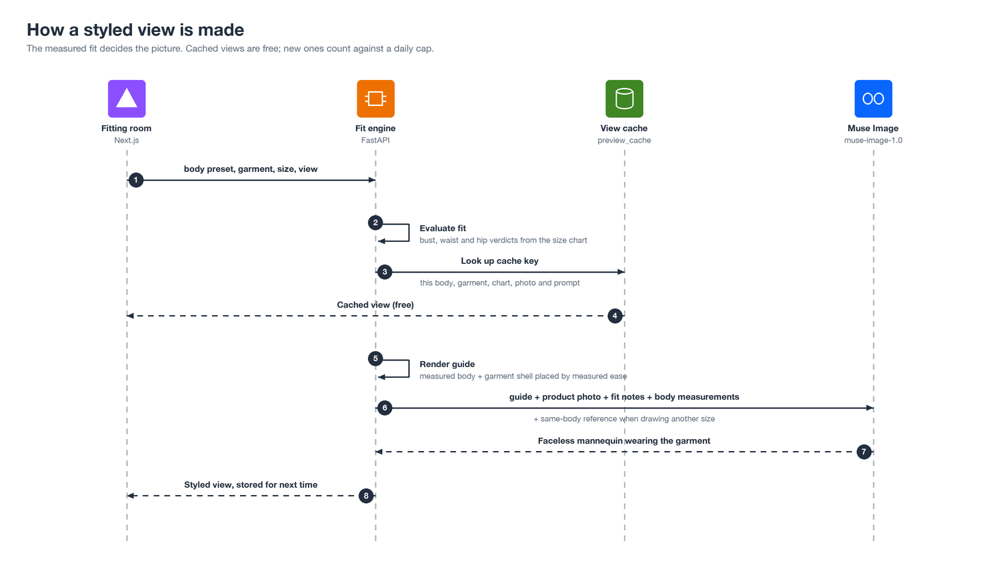
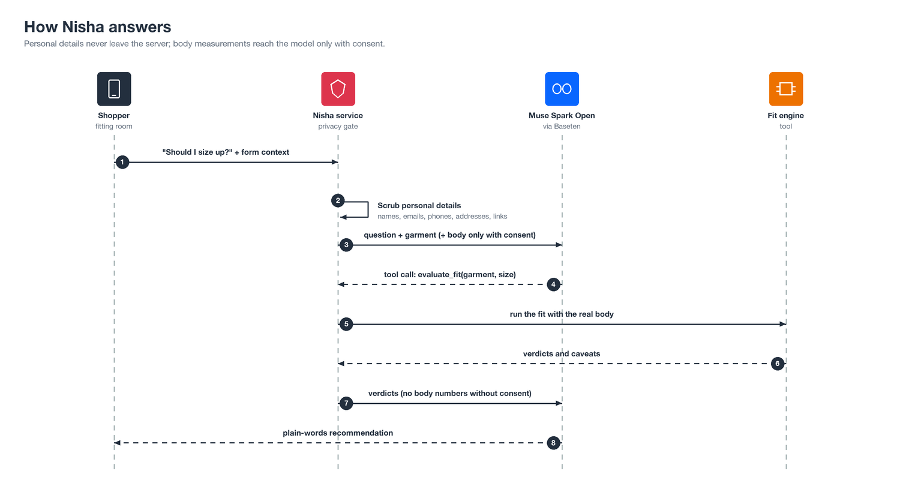

# Stylewise: find your size before you buy

Online shoppers guess their size from a chart, and many guess wrong. **Stylewise shows how each size of a
real garment sits on your body shape**, region by region, and says why. It compares the brand's own size
chart with a body built from your shape and usual size (or your own measurements), then shows the result on a
faceless mannequin with your proportions and lets a sizing assistant, Nisha, explain it in plain words.

**Live demo:** _add link_ · **Video (3 min):** _add link_

Built for the **Meta Global AI Developer Hackathon** (Cerebral Valley), Oct 26 to Nov 4, 2026.
Problem statement: **Build for Your World**.

---

## What it does

| Step | What you see | What happens underneath |
|---|---|---|
| **1. You** | Pick one of five body shapes, your usual size and height, or enter your measurements | A prepared **Meta MHR** body is chosen (for measurements: the closest preset, shown with its centimetres next to yours) |
| **2. A garment** | Browse dresses, tops, skirts, kurta sets and menswear | Each item carries its brand or seller size chart, cited |
| **3. Every size, explained** | A verdict per size and body area: "a little snug at the waist", "+13 cm at the hips", with the sizes either side | The **fit engine** compares garment girths with your body at bust, waist and hip, with fabric stretch and uncertainty |
| **4. See it** | A styled view (front, side, back) and your body in 3D | **Muse Image** draws the garment on a faceless mannequin, guided by a render of the measured body; the 3D view is the MHR mesh |
| **5. Ask Nisha** | "Should I size up?" answered in plain words, by text or voice | **Muse Spark Open** reasons over the engine's verdicts by tool calling; it never invents a number |
| **6. Isolate the garment** | The garment cut out of its product photo | **SAM 3.1** segments the garment pixels |

The landing page is at `/`; the fitting room is at `/try`.

## Architecture



The **Next.js app** (Vercel) serves the landing page and fitting room and proxies to the **fit engine** (FastAPI
on Render). The engine computes every fit from cited size charts and 210 **Meta MHR** body presets fitted offline
on NTU's NSCC cluster. It draws styled views with **Muse Image** (cached, with a daily cap on new images), runs
Nisha on **Muse Spark Open** via Baseten (fallback: Muse Spark), and the app isolates garments with **SAM 3.1**.
Diagram source: `docs/architecture/make_diagrams.py`.

### How a styled view is made



### How Nisha answers



## How Meta's models are used

| Model | Where | Role |
|---|---|---|
| **Meta MHR** (Momentum Human Rig) | Offline, NSCC cluster | 210 body presets (5 shapes × 7 sizes × 3 heights × 2 sexes), fitted to size-chart girths by least squares with explicit Jacobians, with shape cues (shoulder-to-hip, waist depth, a bust-to-underbust cap) so bodies keep natural proportions |
| **Muse Spark Open** (open weights, via Baseten) | Fit engine | Nisha's reasoning with tool calling into the fit engine; falls back to **Muse Spark** on the Meta Model API |
| **Muse Image** (`muse-image-1.0`) | Fit engine | The styled view, guided by our render of the measured body; also generated every product photo in this repository |
| **SAM 3.1** | Next.js route | Isolates the garment in its product photo |

## The fit engine

`fit-engine/` is a Python package (`stylewise_fit`) served with FastAPI.

| Module | Does |
|---|---|
| `fit.py` | Ease per region (garment girth minus body girth), verdicts (tight, snug, fits, roomy), fabric stretch, uncertainty, and an honest note of where the sizes came from |
| `presets.py`, `mhr_body.py` | Shape classes (FFIT), size estimates, preset lookup; MHR fitting (offline) |
| `catalogue.py`, `data/catalogue_garments.json` | Garments with cited size charts (built by `scripts/make_catalogue_garments.py`) |
| `preview.py` | Styled views with Muse Image: prompt, cache key, same-body reference, daily cap |
| `viewer.py`, `scripts/render_fit.py` | 3D body scene and the guide render (body, underwear, moulded hair, garment shell) |
| `nisha.py`, `privacy.py` | Nisha's tool loop on Muse Spark Open, personal-detail scrubbing, consent gating |

| Endpoint | Purpose |
|---|---|
| `GET /health` | Status |
| `GET /catalogue` | Garments, sizes, who they are for, photo availability |
| `POST /fit/outfit`, `POST /fit/evaluate` | Fit reports per garment and size |
| `POST /presets/nearest` | Closest prepared body for entered measurements |
| `POST /preview/photo` | Styled view (cached, or drawn within the daily cap) |
| `POST /viewer/scene` | 3D body scene (GLB) |
| `POST /nisha/chat` | Nisha |

## What is new in this hackathon (and what is not)

**Built during the hackathon:** the MHR body presets and fitting pipeline; the fit engine; the sourced
size-chart catalogue; the styled view with Muse Image (guide render, prompting, caching, same-body reference,
daily cap); SAM garment isolation; Nisha's fit reasoning with tool calling on Muse Spark Open; the privacy
layer; the 3D body model; the landing page and fitting room.

**Reused from our earlier Stylewise project:** Nisha's persona and the browser voice modules
(`src/lib/voice/*`, `src/hooks/useSpeechInput.ts`, `src/hooks/useSpokenReplies.ts`), and catalogue item
names. The earlier wardrobe planner is not part of this project.

## Honesty and privacy

- Ease is a tape-measure difference, not a promise of comfort. Every report says where its sizes came from;
  where a seller does not say whether a chart is body or garment measurements, we state our assumption.
- The styled view is an illustration guided by the measured fit; the measurements decide the fit.
- Nisha: names, emails, phone numbers and addresses are removed on our server before any model call. Your
  measurements are sent to the model only if you tick consent; otherwise the fit runs on our server and the
  model sees only the verdicts.
- The styled view sends a rendered faceless silhouette, never a photo of you. SAM receives product photos only.
- The fit API is stateless: no database, no logging of bodies.

## Data sources and rights

Everything in this repository is either our own work or used within its licence or terms:

- **Size charts:** we store only the **numbers** from public size charts (garment and body measurements), each
  cited per item in `fit-engine/stylewise_fit/data/catalogue_garments.json` with the listing and the date it was
  accessed. Measurements are facts, used here for comparison; no retailer text, images or layouts are copied.
  Three men's items use a reference size chart whose listing was not recorded; their reports say so.
- **Product photos:** every image in `fixtures/garment_photos/` and every styled view was **generated with Meta
  Muse Image** for this project. Early prototypes used retailer product photos as visual references only; the
  submitted version contains none of them.
- **Body data:** Meta MHR (Apache-2.0); ANSUR II anthropometric survey (U.S. Army, public domain); FFIT shape
  thresholds (cited, thresholds only); a general women's retail size chart (numbers only).
- **Models:** used through the Meta Model API and Baseten under their terms of service.
- **Code:** our own, Apache-2.0. Reused voice modules come from our earlier Stylewise project (same authors).

## Run it locally

```bash
npm install
python3 -m venv fit-engine/.venv && fit-engine/.venv/bin/pip install -e "fit-engine[api,dev]"
cp .env.example .env    # then fill in MODEL_API_KEY (dev.meta.ai)
npm run fit:dev         # fit engine on http://127.0.0.1:8000
npm run dev             # app on http://localhost:3000
```

Tests: `cd fit-engine && .venv/bin/python -m pytest -q` (engine) and `npx playwright test` (UI).

### Configuration (`.env`)

| Variable | Used by | Meaning |
|---|---|---|
| `MODEL_API_KEY` | engine, SAM route | Meta Model API key (Muse Image, Muse Spark fallback, SAM) |
| `NISHA_API_BASE`, `NISHA_API_KEY`, `MUSE_MODEL` | engine | Run Nisha on Muse Spark Open via Baseten (`https://inference.baseten.co/v1`, `meta-models/muse-spark-open-1026`) |
| `PREVIEW_DAILY_LIMIT` | engine | New styled views allowed per day (cached views are always free) |
| `PREVIEW_CACHE_ONLY` | engine | `1` serves only pre-generated styled views |
| `FIT_API_URL` | app | Where the app reaches the fit engine |

## Deployment

| Part | Host | Notes |
|---|---|---|
| Next.js app | **Vercel** | Set `FIT_API_URL` to the engine URL |
| Fit engine | **Render** (Docker, `render.yaml`, `Dockerfile`) | Ships the presets and the styled-view cache; `PREVIEW_DAILY_LIMIT=15` caps API spend; no GPU needed |
| Body presets | **NTU NSCC** (offline) | `cluster/nscc_presets.pbs` reproduces all 210 presets |

## Repository layout

```
src/                 Next.js app: landing page (/), fitting room (/try), API routes, 3D viewer, Nisha chat
fit-engine/          Python fit engine (stylewise_fit), scripts, tests, experiments and notes
fixtures/            MHR presets, garment photos, styled-view cache, contract fixtures
contracts/           JSON schemas for fit requests and reports
cluster/             NSCC / TC2 job scripts to regenerate the presets
public/landing/      Landing-page images (styled views from the cache)
```

## Future work

Stylewise shows the intent: size decisions grounded in measurements, explained honestly. Next steps:

- **Cloth simulation** so the 3D view drapes the garment, not only the body, and the styled view keeps the
  mannequin identical across sizes.
- **Your own body from a photo or scan** (e.g. MHR fitting from a phone capture) instead of a preset.
- **Garment measurements from the product page**, read automatically, with SAM 3.1 locating each measured edge.
- **Relaxed, natural poses** for every preset, and more shapes, heights and body types.
- **Retailer integration:** a size check on the product page itself, with returns data to keep improving the fit rules.

## References

- Meta MHR (Momentum Human Rig): https://github.com/facebookresearch/MHR · Ferguson et al., *MHR: Momentum Human Rig*
- Meta Model API and models (Muse Spark, Muse Spark Open, Muse Image, SAM 3.1): https://dev.meta.ai/docs/overview
- Baseten Model APIs (Muse Spark Open): https://docs.baseten.co
- ANSUR II, 2012 U.S. Army Anthropometric Survey (public release): https://www.openlab.psu.edu/ansur2/
- Simmons, Istook and Devarajan (2004), *Female Figure Identification Technique (FFIT) for apparel*, Journal of
  Textile and Apparel, Technology and Management 4(1)
- ISO 8559-1:2017, *Size designation of clothes: anthropometric definitions for body measurement*
- Size-chart sources per garment: see `spec_source` in `fit-engine/stylewise_fit/data/catalogue_garments.json`
  (Amazon SG listings B0DR7MTRZP, B0DHY1L5PX, B0GFV96GTY, B0G5YPHM1J, B01LXJH57H, B0DRD9P9PN, B0B9XFRLXZ;
  Manyavar UC103339; Indubindu kurta-set chart; Uniqlo SG E465193, E487286)

## Team and licence

Riddhima Jain and Vishakha Maheshwari. Licensed under Apache-2.0; see `LICENSE` and `NOTICE`.
