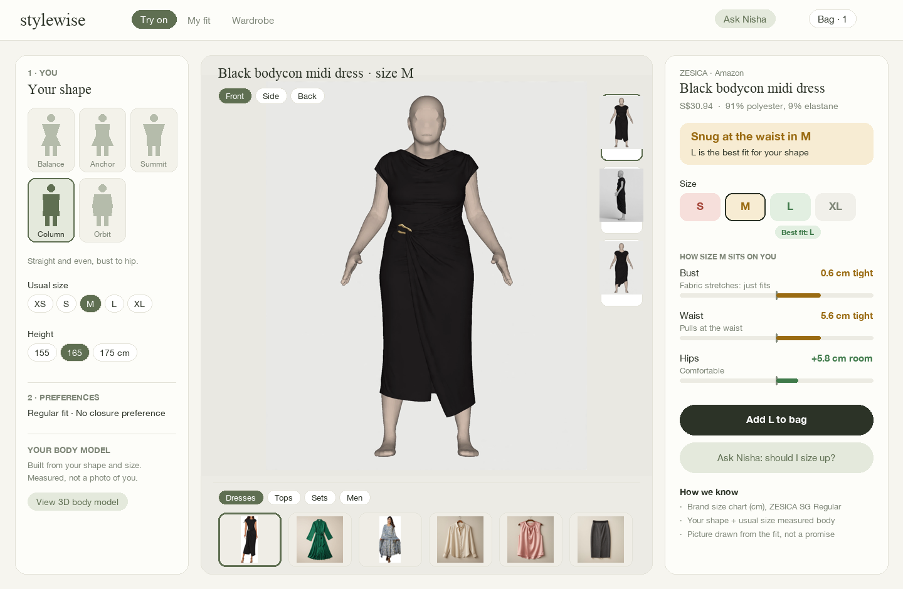
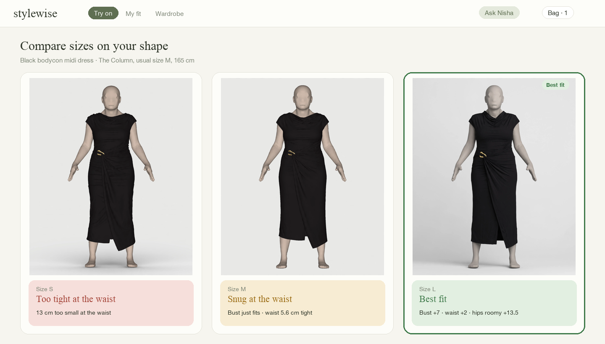
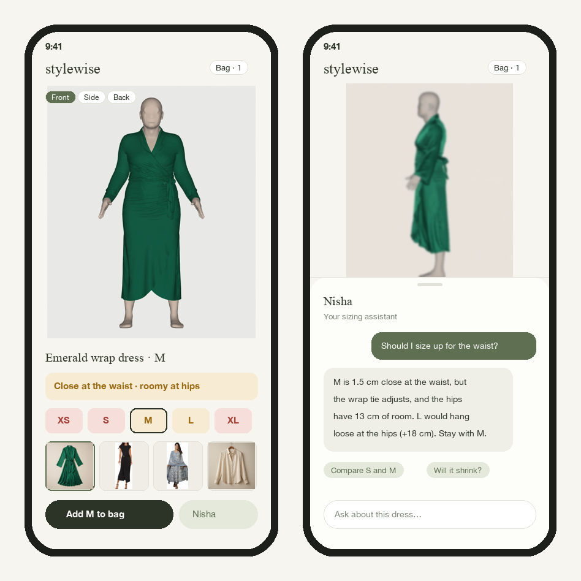
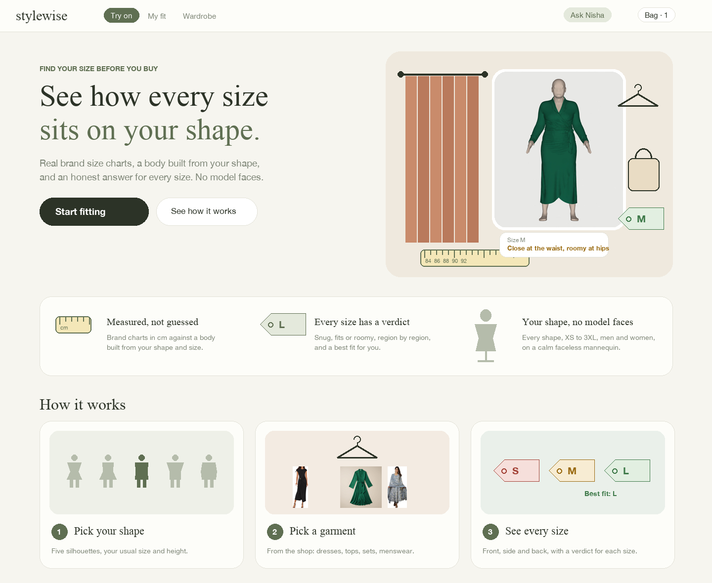

# Fit Lab UI brief (P0 → P1), Nov 3

**Problem:** a first-time viewer could not tell what the page is for. The current page is three dense
columns (inputs | viewer | report) with jargon ("The Balance", "Body S · Garment S", "ease", "±2.5").
It reads like a lab tool, not a shop.

**Goal for the demo:** someone understands it in 5 seconds:

> **"This is me, in this dress, in size S. It fits, but it's roomy at the hips. M would be loose."**

## Reference direction

Riddhima shared screenshots of virtual try-on products (StyleBuddy, Reality Premedia, Markovate, Google
Shopping try-on). What they share, and what we should copy:

1. **One big figure in the centre**, wearing the garment, on a clean light background. Nothing else competes with it.
2. **A garment carousel** under or beside the figure: product thumbnails you tap to swap the outfit ("Create a look").
3. **A shop frame:** product name, price, size, colour, "Add to cart" / "Checkout" pills near the figure.
4. **Category tabs** (Tops · Bottoms · Dresses · Sets), not a dropdown.
5. **Size chips** with a clear selected state, right under the product.
6. Phone-sized flow: works as a single column.

## Our USP: say it on screen

Most virtual try-ons paste a garment onto a model photo: they show *a look*, not *a fit*. Ours is
different, and the UI must say so in the first screen:

| Ours | Typical try-on |
|------|----------------|
| **Real brand size charts (cm)** against a **measured body** built from your shape and size | Garment warped onto a photo |
| **A verdict per size, per region** ("snug at the waist", "+13 cm at the hips") and a **Best fit** | No size answer |
| **Every body shape and size**, XS to 3XL, men and women | A few model bodies |
| **Faceless mannequin**: no comparing yourself to a model | Photoreal model faces |
| **Says why** ("How we know": chart source, measured body) | A black box |

Put a 3-point strip under the header, with small illustrations:

> **Measured, not guessed** (tape-measure icon) · **Every size has a verdict** (size-tag icon) · **Your shape, no model faces** (mannequin icon)

### Visual style

- **Illustrated accents, realistic centre.** Small flat illustrations (a hanger, tape measure, size tag,
  fitting-room curtain, shopping bag), in the spirit of the artlabs and Google Shopping references,
  for empty states, onboarding, the USP strip and loading. The figure itself stays the realistic render.
- **Shop feel:** product card with brand and price, Add to bag, a bag count in the header, a garment carousel.
- **Loading as a moment:** "Measuring the drape…" with an animated tape measure, instead of a spinner.
- **Onboarding (3 illustrated cards):** "Pick your shape" → "Pick a garment" → "See how every size sits".
- Keep the current sage and ivory palette and serif headings: they already read calm and premium.

## Mock-ups

Built from our real demo renders, product photos and the engine's real verdicts for these bodies.
They are the target look, not pixel specs. Source: `docs/mocks/make_mocks.py`.

### 1. Try-on (desktop): the main screen



What to notice:
- **One big figure** in the middle, with view pills (Front / Side / Back) and angle thumbnails on its right.
- **Garment carousel** with category tabs under the figure, instead of a dropdown.
- **Right panel = shop + verdict.** Brand, price and fabric, then the verdict box ("Snug at the waist in M · L is the best fit"), then size chips coloured by fit with a **Best fit** tag, three plain rows with a small tape bar, then **Add to bag** and **Ask Nisha**.
- **Left panel = you.** Shape cards, usual size and height as chips, preferences folded, and the 3D "body model" offered as a secondary link.
- "How we know" (source chart, measured body, not a promise) is small, at the bottom.

### 2. Compare sizes



Three cards side by side, each with its realistic image and a coloured verdict. The best fit is outlined.
This is the clearest "aha" for the demo: same body, three sizes, an honest answer.

### 3. Mobile: try-on and Nisha



Single column: figure, verdict bar, size chips, carousel, then **Add to bag** and **Nisha**. Nisha opens
as a bottom sheet over a blurred figure, with suggested follow-ups.

### 4. Landing and onboarding (illustrated)



The first thing a visitor sees, and where the USP lives:
- **Hero:** "See how every size sits on your shape." with **Start fitting** and **See how it works**.
- **Illustrated fitting room** on the right: curtain, hanger, bag, size tag and tape measure drawn flat,
  around one realistic render with a real verdict card ("Size M · close at the waist, roomy at hips").
  Illustration for the setting, realism for the garment.
- **USP strip** with three icons: tape (*Measured, not guessed*), size tag (*Every size has a verdict*),
  mannequin (*Your shape, no model faces*).
- **How it works:** three illustrated cards: pick your shape (silhouettes) → pick a garment (hanger and
  product photos) → see every size (S/M/L tags coloured by verdict, "Best fit: L").

The illustrations here are drawn with simple shapes as placeholders. P1 can swap them for a consistent
icon or illustration set in the same flat, warm style (clay, sand, sage).

## New layout (single flow, top to bottom)

```
┌─────────────────────────────────────────────────────────────────┐
│ Stylewise            Find your size before you buy.     [Ask Nisha]│
├──────────────┬──────────────────────────────────────┬───────────┤
│ 1. YOU       │                                      │ YOUR FIT  │
│ [shape cards]│       BIG REALISTIC FIGURE           │ ● Fits    │
│ Usual size ▾ │       (front / side / back)          │ Bust +5   │
│ Height ▾     │                                      │ Waist +8  │
│              │   ‹  [thumb][thumb][THUMB][thumb] ›  │ Hip +14 ~ │
│              │      garment carousel by category    │           │
│              │                                      │ Try M →   │
│              │  Black bodycon dress · S$31          │           │
│              │  [XS][S✓][M][L][XL]   [Add to cart]  │           │
└──────────────┴──────────────────────────────────────┴───────────┘
```

## Changes, by priority

### P1-a: must have for the demo

| # | Now | Change to |
|---|-----|-----------|
| 1 | Title "The Balance" over the figure | Garment name + chosen size: "Emerald wrap dress · S". The shape name moves to the left panel only |
| 2 | Badge "Body S · Garment S" | **Verdict chip** from the report: "Fits", "Snug at bust", "Roomy at hips", "Too small at waist". Green / amber / red |
| 3 | Size buttons with no meaning | Colour each size chip by its verdict, and put a **"Best fit"** tag on the recommended one. Tapping a size swaps the image (the images are pre-generated for the demo set) |
| 4 | Garment dropdown | **Carousel of product photos** under the figure, with category tabs (Dresses · Tops · Sets · Men). The engine's `/catalogue` gives `photo: true/false`; photos are at `/api/assets/garment_photos/<id>.jpg` |
| 5 | "S / M at a glance" table with ±2.5, "Borderline", warnings | Three plain rows beside the figure: **Bust +5 cm room · Waist +8 cm room · Hips +14 cm (roomy)**. Hide ±2.5 and the source warnings under "How we know" |
| 6 | Realistic / 3D Measured toggle | Realistic is the default (done). Rename the 3D toggle to **"Your body model"** and present it as the starting point: "This is the body we built from your shape and size". It now shows the same grey, hair-free mannequin as the realistic view (done) |
| 7 | Rings drawn over the realistic image | Remove the rings from the realistic view: they cut across the garment |
| 8 | "Cache disabled" toast, Next.js "N" badge, "Open isolated fixture demo" link | Hide in the demo build |
| 9 | Header "A little more certainty. Before you buy." | Keep the tone but add the action: **"Find your size before you buy."** with a one-line "how": "Pick your shape → pick a garment → see how each size sits" |
| 10 | Nisha is at the bottom, not noticeable | A visible **"Ask Nisha"** button next to the verdict, opening a side drawer. Pre-fill a question: "Should I size up for the hips?" |

### P1-b: nice to have

| # | Change |
|---|--------|
| 11 | Shop frame: price, brand, "Add to cart" pill (no real checkout; it signals the use case) |
| 12 | Left panel: two numbered steps, **1. You** (shape, usual size, height) and **2. Preferences** (folded: fit preference, dressing preference) |
| 13 | Shape cards: name plus a 3-word hint ("The Column: straight, even"). Men see 4 shapes (hourglass hidden, done) |
| 14 | SAM panel: retitle "Isolate the garment from its photo"; its prompt now defaults to the garment's own name instead of "kurta" (done). Move it below the fold as a "How it works" card |
| 15 | Loading state for a not-yet-generated view: show the front image blurred with "Drawing the side view… about 25 s" |
| 16 | Footer note: "Drawn from the brand's size chart and your shape. A visual guide, not a promise." |

## Pre-generated demo set (no live cost, loads instantly)

Body: **The Column (rectangle), usual size M, 165 cm, regular fit**: front, side and back for each:

| Garment | Sizes |
|---------|-------|
| Black bodycon midi dress (ZESICA, Amazon, brand chart in cm) | S, M, L |
| Emerald wrap dress | M |
| Grey printed Anarkali set (PARTHVI, Amazon) | M |
| Cream silk blouse | M |
| Men's textured green kurta (Manyavar chart), male M | M |

Plus whatever was clicked live today (for example The Balance, S, emerald dress S: front, side, back).
Any other combination generates live (about 25 s, one image call), then is cached on disk.

**Demo path:** open on the ZESICA dress (the default) → tap S, M, L and watch the verdict change →
turn to side and back → swap to the emerald dress from the carousel → ask Nisha "should I size up?" →
show "Your body model" (3D) as the measured starting point.

## Known engine-side limits (P0 is on these)

- Some preset bodies read broad or busty for their size in the generated images (especially XS/S). P0 is reviewing the presets against the size chart.
- The 3D "body model" view is a measured shell, not cloth: use it only as "this is the body we built".
- The men's kurta realistic image bunches at the hem; it will be regenerated.
